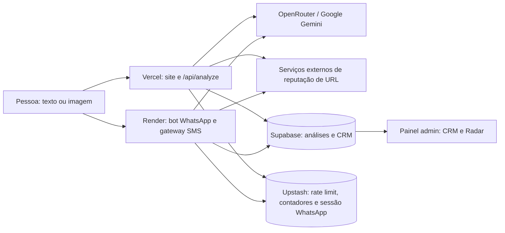

# Análise técnica e de negócio — Confirme, Quem É?

**Data da análise:** 5 de novembro de 2026

**Âmbito:** código, páginas comerciais, documentação, migrações e resultados de benchmark existentes em `files (11)`.
**Método:** revisão estática. Não consultei produção, credenciais, nem a base de dados remota; não executei a suite de testes. O estado local já continha alterações em `bot.js` e `lib/session_store.js`, que foram preservadas.

### Atualização após correções locais

As observações detalhadas abaixo descrevem a baseline inspecionada antes das alterações desta revisão. Foram entretanto aplicadas correções na cópia de trabalho, ainda **não publicadas nem verificadas em produção**:

| Área | Estado na cópia de trabalho |
|---|---|
| Servidor Render | Estado público reduzido; emparelhamento, QR, teste de IA e estado administrativo protegidos; pedidos limitados e validados. |
| Health checks | O keep-alive interno periódico do Supabase foi removido. `GET /ping` verifica apenas que o processo responde; `GET /status` consulta Supabase com cache curto e não expõe dados de emparelhamento. |
| SMS e endpoints web | Webhooks de SMS exigem assinatura Twilio ou segredo de integração; análise, feedback, leads e tentativas administrativas têm limites e validação. |
| Consulta e emblemas públicos | `/verify/:codigo` exige registo ativo, empresa ativa e validade; consultas são limitadas e pedem apenas campos públicos necessários. NIF/IBAN foram retirados da resposta pública e os badges estáticos foram removidos; os SVG consultam o estado atual e falham fechados. |
| Logs e conteúdo comercial | Removidos logs do texto/remetente nos caminhos revistos; landing, termos, privacidade, README e apresentações ajustados para descrever limites reais. |
| Sessão WhatsApp | Novas cópias para Redis usam AES-256-GCM e expiram após 180 dias sem sincronização; o logout apaga a cópia remota. |
| Dados de demonstração | Seed marca empresas e selos como teste; criação e limpeza exigem confirmação do projeto e recusam `NODE_ENV=production`. A limpeza continua a ser uma operação destrutiva e não foi executada. |
| Retenção | A tabela de prazos e a migração `20261105_retencao_rgpd.sql` estão implementadas localmente. O Supabase Cron agenda a limpeza diária quando a migração é aplicada; não acedi ao projeto para a executar ou confirmar. |
| Produção | Não acedi ao Render, Vercel, Supabase ou Upstash, não alterei o monitor externo e não confirmei variáveis de ambiente, cadência ou respostas dos pings. |

Informaste que um servidor externo envia pings ao Render e ao Supabase. Se ele faz pedidos HTTP de entrada regulares ao serviço Render, isso pode evitar períodos sem tráfego e reduzir o risco de suspensão por inatividade. É uma inferência baseada na descrição: não verifiquei esse processo, e os pings não demonstram SLA, ligação efetiva do WhatsApp, processamento correto nem recuperação de falhas. Um ping ao Supabase feito separadamente também não substitui um health check da aplicação.

## 1. Síntese executiva

O repositório contém um MVP implementado com dois ativos principais: um verificador B2C de mensagens e uma página pública para consultar canais empresariais. Há também um painel interno com CRM, revisão manual, agregação de sinais submetidos e geração de resumos. Esta revisão não verificou a execução em produção.

**A recomendação é limitar a operação a um piloto B2B manual e pequeno. O sistema não está pronto para vender monitorização empresarial 24/7, telemetria de rede móvel, alertas em tempo real, API em lote, serviço pericial ou takedown.** Essas promessas não correspondem ao que o código entrega.

Antes das correções locais, havia três bloqueios imediatos, agora tratados na cópia de trabalho mas ainda por implantar e confirmar:

1. O servidor público do bot expõe endpoints de emparelhamento, estado e teste sem autenticação. O estado inclui o QR e o código de emparelhamento.
2. A página de empresas mostra métricas sintéticas de marcas reais como se fossem sinais operacionais e afirma capacidades que não estão implementadas.
3. A política de privacidade promete anonimização e não utilização para treino, mas o texto e as imagens são enviados sem anonimização prévia a serviços externos; além disso, os logs do bot guardam excertos da mensagem e o remetente.

O caminho comercial mais seguro é validar manualmente uma **página pública de canais empresariais**, com revisão, validade, evidência e limites claros. O preço indicativo de €49/mês ainda não foi validado; acompanhamento manual precisa de escopo, capacidade e prazo definidos antes de ser vendido. Três pilotos podem ensinar sobre utilização e custos, mas não demonstram retenção, margem ou possibilidade de escalar.

## 2. Sistema observado

O desenho é adequado para experimentar com poucos utilizadores: site estático e funções serverless, um processo Node de longa duração para WhatsApp, Supabase via REST, Redis e APIs externas de IA/reputação. O custo de manter isto como operação comercial ainda não está demonstrado: depende de planos, volume, chamadas externas e horas humanas.

| Capacidade | O que o código evidencia hoje |
|---|---|
| Análise B2C | Texto e imagem são analisados por LLM; há regras para links, heurísticas locais e persistência de metadados. |
| Registo empresarial | Página pública `/verify/:codigo`, consulta de código/domínio e emblema SVG dinâmico. O estado depende de campos administrativos; a validação é operacional/manual e não certifica uma entidade perante terceiros. |
| Threat Radar | Agregação interna de análises voluntariamente submetidas, com extração de marcas e indicadores. Não observa passivamente redes móveis nem mensagens privadas de terceiros. |
| CRM e pagamentos | Registo administrativo de empresas, verificações, contactos e pagamentos. Não encontrei checkout, cobrança recorrente ou confirmação automática de pagamento. |
| Relatórios/takedown | Há geração de texto e resumo com hash. Não há submissão automática a registrars, bancos, SIBS, CERT.PT ou operadoras. |
| Integração empresarial | Existe consulta pública por código/domínio. Não encontrei autenticação por cliente, API em lote ou envio de webhook para SOC. |

### Fiabilidade da documentação existente

Os documentos de auditoria são snapshots, não uma prova atual de prontidão. O relatório de produção de 25 de setembro afirma 34/34 testes aprovados e lista garantias que não cobrem todos os endpoints públicos. O gate da landing de 20 de outubro classifica a página como pronta, apesar de o HTML atual conter um Radar demonstrativo com contagens fixas e alegações de telemetria móvel/24×7. Já o manual comercial diz que as páginas de Termos/Privacidade e o IBAN não existem, mas esses artefactos e campos estão presentes no estado atual. A auditoria deve ser revalidada contra o código e ambiente vigentes antes de apoiar uma venda ou deploy.

## 3. Achados técnicos prioritários

### P0 — O painel do bot expõe material de emparelhamento

Em `bot.js`, o servidor escuta em `0.0.0.0`, ativa CORS `*` e serve `/status`, `/ping`, `/request-code`, `/test-ai` e `/api/sms` sem autenticação. `/status` serializa todo o objeto `currentStatus`, que contém `qrBase64`, `pairingCode`, telefone e erros. `/request-code` aceita GET e POST e permite pedir um código para o telefone recebido na query string. `/test-ai` aceita texto arbitrário e executa uma análise.

Como `render.yaml` declara um Web Service público no Render, estes caminhos devem ser tratados como acessíveis pela Internet. O risco prático inclui apropriação/abuso do emparelhamento quando o bot está desligado, exposição de credenciais temporárias e consumo de IA. O QR de uma sessão WhatsApp é segredo de autenticação.

**Ação:** remover do estado público QR, código e número; proteger operações de emparelhamento com autenticação forte e acesso restrito; desativar `/test-ai` em produção; restringir CORS; limitar pedidos e separar health check de estado operacional. Não deixar o código de emparelhamento em query string ou resposta pública.

### P1 — Webhooks e endpoints de custo aceitam pedidos não autenticados

`api/sms.js` aceita GET e POST, não valida assinatura do Twilio/gateway e regista o remetente e até 80 caracteres da mensagem. A rota equivalente em `bot.js` também processa conteúdo sem validar o fornecedor. `api/analyze.js` limita apenas `/api/analyze`; esse limite depende de Redis e permite a chamada quando Redis falta, responde mal ou falha. O endpoint de leads em `api/empresa.js` permite CORS universal e não tem proteção contra submissão automatizada. O endpoint de feedback aceita avaliações sem rate limit.

Isto abre espaço a abuso de custo, falsificação de sinais no Radar e acumulação de dados de contacto falsos. Uma assinatura válida é particularmente importante antes de tratar chamadas como provenientes de Twilio ou de uma operadora.

**Ação:** validar assinatura e timestamp do fornecedor; rejeitar GET nos webhooks de escrita; aplicar limites por IP, telefone e chave de integração em todas as rotas com custo ou persistência; limitar tamanho e formato; colocar CAPTCHA ou controlo equivalente no formulário de leads; não registar conteúdo de mensagens.

### P1 — A política de privacidade não descreve o fluxo real

O scanner envia o texto integral e a imagem original ao fornecedor de IA antes de produzir `texto_normalizado`. A normalização pedida ao modelo ocorre depois de o conteúdo já ter sido transmitido. O código também consulta fornecedores externos de reputação usando URLs/domínios detetados. Entretanto, `api/sms.js` e `bot.js` escrevem excertos da mensagem e remetente nos logs. O `lib/session_store.js` guarda o bundle de autenticação WhatsApp em Base64 no Redis; Base64 não é cifragem.

O texto público afirma que nomes e identificadores são descaracterizados, que as configurações empresariais impedem treino e que os registos são eliminados de acordo com prazos definidos. Não encontrei pré-redação, confirmação da configuração de cada fornecedor ou rotina que apague análises após 24 meses. O `.env.local` está ignorado pelo Git e não foi aberto; não verifiquei a configuração real dos fornecedores.

Este ponto é material: a tabela de preços da Gemini indica que o conteúdo do nível gratuito pode ser usado para melhorar produtos; para o nível pago indica que não. A política de privacidade da OpenRouter explica que as práticas de retenção/formação também dependem do modelo/provedor selecionado. A aplicação não fixa uma rota europeia nem declara configurações de retenção no pedido. ([Gemini API: preços e uso dos dados](https://ai.google.dev/gemini-api/docs/pricing), [OpenRouter: privacidade](https://openrouter.ai/privacy))

**Ação:** documentar o fluxo antes de continuar a prometer anonimização; decidir explicitamente fornecedor, modalidade paga, região, retenção e acordo de tratamento; remover texto/telefone dos logs; definir TTL e apagar dados na base de dados; cifrar o bundle WhatsApp antes de o armazenar. A política deve identificar a entidade responsável, os subprocessadores efetivamente usados, a base de tratamento por finalidade, os prazos implementados e um contacto funcional. A CNPD relembra minimização, finalidade, exatidão e limitação da conservação como princípios do RGPD. ([RGPD, art. 5.º](https://eur-lex.europa.eu/eli/reg/2016/679/oj))

### P1 — Sinais do Radar não equivalem a denúncias confirmadas

O contador `vezes_reportada` é incrementado por hash do texto, sem distinguir pessoas diferentes. A agregação usa esse valor como peso e o campo `golpes_confirmados` é preenchido a partir do número de ocorrências. Não existe uma revisão humana obrigatória antes de esse resultado alimentar a severidade e os dossiês. Uma repetição automatizada ou o mesmo utilizador a submeter várias vezes pode inflacionar um indicador.

O gerador em `lib/radar.js` chama o documento de “pericial” e “RGPD-compliant”, produz um hash de metadados e pode incluir uma mensagem genérica como evidência quando não recebe exemplos. Esse hash não demonstra a origem nem a integridade de uma prova original, e o gerador não submete pedidos de takedown. Recomendo rotular estes dados como **sinais automatizados/submissões observadas**, nunca como crimes confirmados; exigir validação humana e proveniência antes de recomendar bloqueios ou notificar terceiros.

### P1 — O benchmark existente é pequeno e sintético

O relatório de 16 de outubro descreve 20 exemplos sintéticos internos — dez ataques e dez legítimos — executados em três voltas. Reporta 95% de acerto em algumas voltas, mas também 10% de falsos positivos. A própria análise diz que a generalização para golpes não catalogados assenta em quatro exemplos. Isto é útil para regressão, não para anunciar 95% de precisão geral nem para sustentar uma decisão de bloquear pagamento.

**Ação:** manter o benchmark como teste de regressão e montar uma avaliação separada com mensagens independentes, rotulagem humana dupla, categorias novas, divisão temporal e intervalos de confiança. Medir falsos negativos, falsos positivos por categoria, calibração, custo e latência. A resposta “legítimo” deve dizer “sem indicadores encontrados”, sem ser tratada como certificação de segurança.

### P1 — Disponibilidade e tempos de resposta não estão compatíveis com a promessa

`render.yaml` configura o bot num plano `free`. A documentação do Render diz que serviços gratuitos podem parar após um período sem tráfego de entrada e têm filesystem efémero. Os pings internos ao Supabase não contam como tráfego de entrada no Render. Segundo a tua descrição, existe agora um monitor externo que também contacta o Render; se esse pedido chega regularmente ao serviço web, pode reduzir o risco de suspensão por inatividade. Não verifiquei frequência, rota nem resposta. Mesmo com pings, o plano não garante SLA, funcionamento do WhatsApp ou processamento de pedidos. ([Limitações dos serviços gratuitos Render](https://render.com/docs/free))

O scanner ainda faz tentativas sequenciais com timeout de 20 segundos no OpenRouter e até 10 segundos por modelo direto Gemini. Sem um prazo global, falhas em cascata podem alongar bastante a resposta. Na configuração Vercel Hobby sem Fluid Compute, a duração padrão documentada é 10 segundos; a duração real depende do plano/projeto e não foi verificada. ([Limites de funções Vercel](https://vercel.com/docs/functions/limitations))

**Ação:** manter o monitor externo e fazê-lo verificar um health check que represente dependências e capacidade de resposta, com alertas quando falhar. Usar serviço pago/estável se houver compromisso de continuidade. Definir um orçamento global de latência com circuit breaker e fallback; medir em produção antes de anunciar resposta “instantânea”.

### P2 — Segurança administrativa suficiente só para operação interna mínima

O admin usa uma chave partilhada por `x-admin-key`, aceita também `secret` no corpo e guarda a chave em `localStorage`. Isto é melhor do que uma password hardcoded no servidor, mas uma única chave dá acesso global ao CRM, dados de empresa, pagamentos, evidências e relatórios; um XSS no painel ou computador partilhado pode expô-la. Não há contas individuais nem revogação por operador.

As migrações ativam RLS em tabelas de CRM e permitem acesso ao `service_role`, o que é coerente com chamadas server-side. A arquitetura deve continuar a manter essa chave fora do browser. Antes de adicionar operadores ou clientes, trocar a chave global por autenticação com identidade, sessões curtas, auditoria por utilizador e privilégios mínimos.

### P2 — Faltam controlos comerciais e de dados para escala

O admin obtém muitas tabelas numa única chamada; várias respostas HTTP não-OK viram arrays vazios sem necessariamente marcar a base como degradada. Sinais e ocorrências são limitados a 1.000 e 100 linhas, respetivamente, sem paginação para o operador. Isto é suficiente para um piloto pequeno, mas pode mostrar um Radar incompleto sem o indicar.

O painel `admin.html` tem cerca de 372 KB e concentra muitas funções; `lib/golpes_novos.js` junta fluxos de alerta, revisão e benchmark. É uma superfície grande para alterações. `render.yaml` usa `npm install` e as dependências incluem Baileys numa versão RC. Antes de crescer: builds reprodutíveis (`npm ci`), análise de dependências, paginar, assinalar falha parcial, backups e uma suite de CI. As migrações e testes já existentes são um ponto positivo, mas a existência dos testes não substitui execução ou monitorização.

## 4. O produto vendável e o que ainda é promessa

| Mensagem comercial atual | Situação observada | Decisão recomendada |
|---|---|---|
| Página pública e emblema dinâmico do registo | Implementado; estado e campos dependem de revisão administrativa manual. O emblema não prova quem controla um canal nem impede personificação. | Se houver piloto, descrevê-lo como consulta de dados indicados e revisão manual com data, validade e limites explícitos. |
| Radar e monitorização “24/7”, telemetria móvel nacional, sinais antes da polícia/blacklists | A análise depende de submissões voluntárias e feeds externos; não há integração a redes móveis nem serviço contínuo de alerta. | Retirar essas expressões. Se houver pilotos, descrever frequência de revisão manual e cobertura real. |
| API de validação em lote e webhook SOC em tempo real | Não encontrei endpoint de lote, autenticação de cliente ou webhook de saída. `/api/sms` é um webhook de entrada e não está autenticado. | Não anunciar até existir contrato de API, autenticação, limites e testes de entrega. |
| Takedown/relatório forense | O painel gera texto e hash de metadados; não verifica autonomamente prova nem executa derrube. | Chamar “resumo técnico preliminar”; revisão humana e confirmação independente antes de qualquer encaminhamento. |
| Demonstração de surto com Millennium, CTT e outros nomes; volumes 34/36 | O HTML contém dados de demonstração estáticos sem um aviso visível de que são sintéticos. Pode parecer uma denúncia real contra marcas identificáveis. | Substituir por marcas fictícias e uma tarja visível “dados ilustrativos” ou remover imediatamente. |
| Planos Start/Pro/Enterprise e “7 dias grátis” | A landing anuncia €29/€49/€290 e inclui domínios múltiplos, vistas ilimitadas, API, relatórios e gestor dedicado. O modelo de negócio mais recente descreve €49 pelo selo e €290 por acompanhamento manual, limitado a 1–2 clientes e sem prazo garantido. Não encontrei billing, teste automático ou API correspondente. | Unificar oferta, preço e termos numa fonte única. Não cobrar por capacidade que depende de um sistema ainda não construído. |

A landing também promete “maior confiança na conversão”, “verificado em tempo real”, proteção contra clonagem e “dossiê forense” sem evidência própria ou ensaio A/B. O documento de auditoria da landing já reconhece divergências de preços e métricas sem fonte, mas depois classifica monitorização 24/7 como verificada; essa conclusão não é apoiada pela arquitetura observada.

## 5. Análise de negócio

### Cliente inicial

O problema existe: pacientes, compradores ou clientes podem receber pedidos de pagamento de alguém que se faz passar por uma empresa. O benefício mais demonstrável hoje é um **canal de confirmação independente e fácil de partilhar**. O selo só cria valor se a empresa o distribuir nos seus próprios contactos, faturas e páginas; a página isolada não muda o comportamento do cliente.

Eu escolheria um só segmento para os primeiros pilotos — por exemplo, agências imobiliárias expostas a pedidos de sinal ou clínicas com marcações/cobranças por WhatsApp — e mediria se a equipa realmente envia a página de verificação aos clientes e se isso reduz dúvidas, reclamações ou chamadas. E-commerce pode ser um segundo teste, mas o alegado aumento de conversão precisa de medição própria.

### Oferta e preço

O documento `MODELO_NEGOCIO_FREE_MIDIA_PR.md` é mais prudente do que o pitch: €49/mês para o selo e €290/mês para acompanhamento manual, apenas para empresas com sinal observado; admite capacidade de 1–2 clientes e sem SLA. A landing pública contradiz esse recorte e descreve três tiers com funcionalidades não implementadas.

€49/mês é uma hipótese de preço, não um preço validado. Se o serviço for apenas emissão de um selo, o cliente pode questionar a recorrência. A subscrição precisa de uma rotina recorrente explícita — por exemplo, rever canais e validade numa cadência definida, manter a página e prestar suporte — ou a empresa deve testar também um preço anual/por verificação. Para €290, definir quantas revisões, entregáveis, prazo de resposta e limites de responsabilidade; não chamar “24/7”.

Os documentos de projeção supõem dezenas/centenas de empresas, contratos corporativos e telcos em 24 meses, sem evidência de pipeline, taxa de conversão, CAC, churn, horas de suporte ou custo de IA. €147 MRR com três clientes a €49 valida que alguém paga; não prova margem nem sustentabilidade. A conta de “87% de margem” exclui trabalho do fundador, aquisição, impostos, IVA, suporte e chamadas pagas. Para prestação habitual de serviços em Portugal, confirme enquadramento e início de atividade antes de começar a faturar; a Autoridade Tributária exige a declaração antes do início e emissão de fatura pelos serviços prestados. ([Portal das Finanças: início de atividade](https://info.portaldasfinancas.gov.pt/pt/apoio_ao_contribuinte/Cidadaos/Atividade_profissional/Declaracoes_de_atividade/Inicio_de_atividade/Paginas/default.aspx), [faturas e recibos](https://info.portaldasfinancas.gov.pt/pt/apoio_ao_contribuinte/Cidadaos/Atividade_profissional/Fatura_e_recibo/Paginas/default.aspx))

### Diferenciação e defesa

O LLM e a análise de URL são componentes substituíveis. A vantagem potencial não é “ter IA”; é combinar canais empresariais verificados, instruções práticas para consumidores, sinais locais bem rotulados e uma relação de confiança com marcas. Essa vantagem só aparece com dados de qualidade, distribuição e um processo de verificação consistente. Hoje o dataset documentado é sintético e pequeno, e o Radar não prova autoria ou unicidade dos denunciantes.

Por isso, não vender já um feed de ameaças como inteligência de nível SOC. Primeiro validar se empresas aceitam a página, se os consumidores a usam, qual a frequência de atualização que tem valor e quanto tempo manual consome por cliente.

### Risco regulatório e reputacional

Há três planos distintos: conteúdo enviado pelo consumidor a fornecedores de IA, sinais sobre pessoas/canais suspeitos e dados comerciais/identificadores empresariais. A política deve descrever cada plano sem alegar “anonimização” quando só se remove o texto antes da persistência, depois de o enviar a terceiros. Números, IBAN e contactos de empresários em nome individual podem identificar pessoas. O selo também expõe NIF e, se marcado como verificado, IBAN na página pública; essa divulgação precisa de autorização e validação rigorosa.

O Regulamento da IA é aplicável, em geral, desde 2 de agosto de 2026. A classificação de risco depende da finalidade concreta; não se deve presumir que este verificador é automaticamente de alto risco. Ainda assim, convém documentar finalidade, transparência perante o utilizador, supervisão humana e tratamento de erros. ([Regulamento (UE) 2024/1689](https://eur-lex.europa.eu/eli/reg/2024/1689/oj))

O canal WhatsApp usa Baileys, cliente não oficial. Os termos do WhatsApp restringem exploração automatizada ou acesso não autorizado e permitem tomar medidas sobre contas que violem os termos. Esse canal tem risco de interrupção e de conta; não o use como pilar de SLA ou de receita recorrente. ([Termos do WhatsApp para o EEE](https://www.whatsapp.com/legal/terms-of-service-eea?lang=en))

## 6. Plano recomendado por prioridade

### Agora — bloquear riscos imediatos

1. Fechar os endpoints públicos de emparelhamento/estado/teste do Render; filtrar o que `/status` devolve e exigir autenticação nas ações operacionais.
2. Verificar assinatura de Twilio/gateway, retirar logs de texto e número, negar GET nos webhooks de escrita e limitar todas as rotas que chamam IA ou gravam dados.
3. Retirar ou rotular claramente os dados sintéticos da página de empresas. Suspender os claims de 24/7, rede móvel, alertas em tempo real, API em lote, takedown executado e serviço pericial.
4. Alinhar política de privacidade e termos com o fluxo real; configurar fornecedor/modelo e modalidade de API compatíveis com o compromisso de privacidade que será publicado.
5. Confirmar ambiente de produção e capacidade: o bot está num plano Render gratuito no manifesto. Se houver um serviço Vercel Hobby, confirmar também que o plano permite a utilização comercial pretendida; a página oficial descreve Hobby como uso não comercial. ([Vercel Hobby](https://vercel.com/docs/plans/hobby))

### Antes de cobrar os primeiros clientes

1. Escrever procedimento de verificação (fonte, evidência, revisor, data, validade, renovação e revogação) e guardar evidência de cada decisão.
2. Fixar uma oferta piloto, preço, limites, cancelamento, IVA/fatura, suporte e um prazo de resposta realista. Separar selo de monitorização manual.
3. Fazer três pilotos pagos no mesmo segmento e acompanhar: contactos feitos, reuniões, conversão, tempo de onboarding, horas por mês, utilização da página, alterações de contactos, renovação e cancelamentos.
4. Criar benchmark externo com rotulagem independente e publicar apenas métricas acompanhadas de tamanho de amostra, distribuição e limites.

### Antes de vender a empresas maiores

Adicionar autenticação/escopos por cliente, API e webhooks assinados, paginação e revisão humana antes de etiquetar IOC como confirmado. Confirmar no ambiente real os backups, o job de retenção, alertas operacionais e um processo de resposta a incidentes. Contratar disponibilidade compatível com a promessa.

## 7. Veredito

**MVP técnico: sim. Piloto comercial manual e restrito: sim, depois dos bloqueios imediatos. Oferta de monitorização 24/7/enterprise, telco ou perícia: não sustentada pela implementação e pelos dados atuais.**

O maior risco do projeto hoje não é falta de funcionalidades. É a distância entre um produto de validação manual/automática de sinais e a narrativa pública de uma rede nacional de threat intelligence. Fechar essa distância aumenta a confiança e torna o primeiro contrato mais fácil de cumprir.

## 8. Estado de conclusão desta revisão

As correções de código e conteúdo feitas nesta cópia não foram implantadas. Antes de considerar os achados técnicos fechados em produção:

1. Definir e guardar no Render/Vercel as chaves `ADMIN_SECRET_KEY`, `UPSTASH_REDIS_REST_URL`, `UPSTASH_REDIS_REST_TOKEN`, `WHATSAPP_SESSION_ENCRYPTION_KEY` e a autenticação do fornecedor SMS que efetivamente será usado.
2. Confirmar que `TWILIO_WEBHOOK_URL` corresponde exatamente ao URL configurado no fornecedor, se for Twilio.
3. Configurar a chave de cifragem, iniciar o serviço para migrar a cópia legada da sessão WhatsApp e confirmar que o Redis apresenta TTL de 180 dias.
4. Rever a cadência, o URL e os alertas do monitor externo; este não foi alterado nem verificado nesta revisão.
5. Rever os totais de `supabase/retention_preview.sql`, confirmar um backup recuperável, aplicar `supabase/migrations/20261105_retencao_rgpd.sql` no Supabase de produção e confirmar que o job `zapqueme-retencao-dados` está ativo e a correr. Os prazos e a base legal estão em `docs/RETENCAO_DADOS.md`.
6. Confirmar o endereço legal antes de publicar: foi transcrito como fornecido — “Av Don Pedro V, 33 - 351” — mas o trecho “351” pode estar incompleto ou pertencer ao código postal.
7. Publicar e validar manualmente o comportamento dos endpoints e das páginas no ambiente real; nenhum deploy foi feito nesta revisão.
